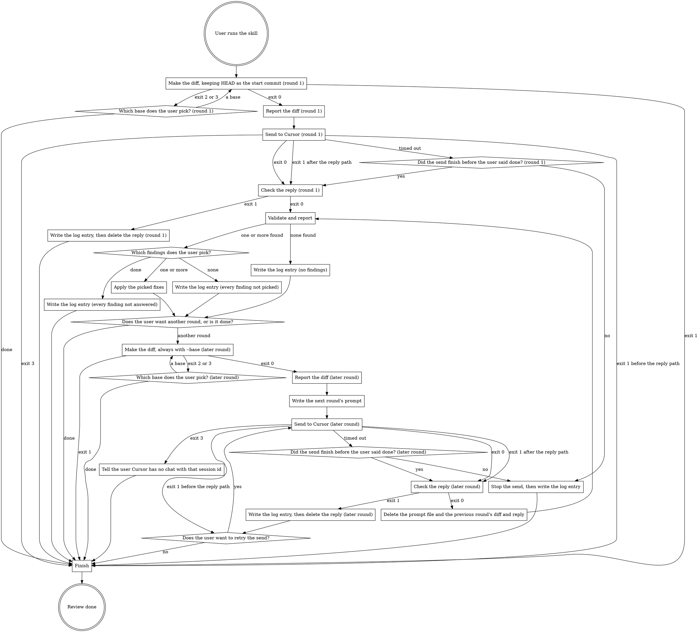

<!-- playbook:x-review-with-cursor-next v1 (2026-10-21) — flow in one flowchart; steps named, not numbered -->
<!-- source: andrej-kolic/playbook .rulesync/skills/x-review-with-cursor-next/SKILL.md; edits elsewhere are overwritten -->

Work in progress. A Cursor run costs money on the user's Cursor plan.

## Flow

Only the flowchart says what comes next. From "User runs the skill", follow one edge at a time and do only what the current box says: a step from Steps, or an action in itself. A diamond about what the user wants or picks is a question: ask it, then wait. A "Did the send finish before the user said done?" diamond is not a question: its answer comes from the wait in Send to Cursor. An `exit N` edge follows the script's exit code. A round is one send to Cursor and the work on its reply.



## Steps

When a script fails, show its error lines. If they name "Authentication required", tell the user to run `agent login`.

### Make the diff

From the user's current folder, run `sh "<this skill's folder>/scripts/make-diff.sh"`.

In round 1, add `--base <ref>` only when the user named a base branch or commit, or picked one after exit 2 or 3. Before the first run, also run `git rev-parse HEAD` and keep it as the start commit.

In a later round, always add `--base <ref>`, with `<ref>` the first of: the base the user picked after exit 2 or 3 in this round; the `<commit>` from the base line of the latest run where the user picked a base; the `<commit>` from round 1's base line; the start commit.

It prints the diff file's path; set `p` to it. With a base, named or default, a second line follows: `base <ref> <commit> named|default [uncommitted]`. Exit 2 means the branch is stacked on another; exit 3 that the named base is unknown, a commit not in this branch's history, or a branch with no shared history. To ask which base to use, offer the default branch and, for exit 2, the branches its error names.

### Report the diff

With `c` the `<commit>` from the base line, run:

```sh
wc -c -l < "$p"
git -C "$(git rev-parse --show-toplevel)" apply --numstat --summary "$p"
```

With a base line, also run `git log --oneline "$c"..HEAD`.

Show the user: what it covers ("uncommitted changes", or "since `<ref>`" (named or default), plus "and uncommitted changes" when the base line says so, and the commits); the diff's path as a `file://` link; its lines and bytes; each changed file with lines added and deleted, and any rename, new or deleted mark.

### Write the next round's prompt

Write this prompt to a temp file from `mktemp`, with the latest round's numbers and, for each finding not fixed, the reason from Validate and report or from the user. A fix whose check failed is not fixed, with reason `fix applied, check failed`: `Addressed. Fixed: <numbers>. Not fixed: <number> (<reason>), …. Do another round on the change included below as a diff. Treat the findings not fixed as settled: raise one again only if the new code changes it, and say what changed. My reasons are not proof: if a finding I did not fix is still a real bug, raise it again and say why.`

### Send to Cursor

With a 10-minute timeout, run:

1. In round 1: `sh "<this skill's folder>/scripts/send-review.sh" "$p"`, adding the model id as a second argument only when the user named one. The default is `grok-4.7-high-fast`.
2. In a later round: `sh "<this skill's folder>/scripts/send-review.sh" --resume <session> <prompt file> "$p" <model>`, with the session id from Check the reply and the model round 1 used. A retry sends the same prompt file again.

It prints the reply file's path before Cursor starts; set `r` to it. An exit 1 is "after the reply path" when that path was printed, and "before the reply path" when it was not.

At the timeout the command keeps running in the background, its output (reply path first) going to the file the timeout message names. Tell the user and wait for the notice that it finished, or for the user to say done. Until then, delete no file.

### Check the reply

Run `sh "<this skill's folder>/scripts/read-reply.sh" "$r"`.

It prints `session <id>`, a `tokens` line, and a `tool <name> refused` or `tool <name> not refused: <outcome>` line per tool call that was not a read or search.

Read the review with `tail -n 1 "$r"`, its `result` field. Never read the whole file: it holds every file Cursor read. Skip Cursor's lead-in before the findings.

### Validate and report

Validate each finding against the current code; per finding, run one narrow check (a test file, a type check) when one exists. Mark Skip a finding the code proves false, or an old problem this change did not cause; it stays in the report. Apply nothing. Report:

1. First, any `not refused` tool call from Check the reply and what it could have done.
2. Counts, then Fix / Skip / Needs your decision, one line per finding: Cursor's number, severity, `file:line`, the problem, and for Fix the fix. High severity first.
3. One line: model, session id, tokens, reply file link.

### Apply the picked fixes

Apply only the findings the user picks, by Cursor's number. Then run each applied finding's check again, and report pass or fail per finding; say when a finding has no check. Do not commit unless the user asks. Write the log entry.

### Write the log entry

Append an entry for the round to `x-review-with-cursor-log.md` in the folder `grounder path plans` prints; if that command fails, tell the user the log was skipped. Create a missing folder or file; a new file starts with frontmatter: a `---` line, `project: <repo folder name>`, `created: <YYYY-MM-DD>`, a `---` line.

`- <YYYY-MM-DD>, <branch>, session <first 8 characters of id>, round <n>, <wc -l from Report the diff> lines, <duration_ms from the reply's last line ÷ 1000, rounded> s, <model>, tokens <input>/<output>/<cache read>/<cache write>, <number of Cursor's findings> found[. Note: <note>]`
`  - <Cursor's number>, <severity>, <file:line, or file>, <problem in a few words>, <Fix | Skip | Needs your decision>: <reason or fix>, <picked, check passed | picked, check failed | picked, no check | not picked | not answered>`

Each of Cursor's findings gets a line, Skip ones included. A field a failed or stopped send leaves unknown is `?`; a retry is a new entry with the same round and `retry` added to its note. Note only the unusual, in exactly these words, joined by `; `:

1. `timed out`: the send ran past the 10-minute timeout.
2. `reply check failed`: written at a "Write the log entry, then delete the reply" box.
3. `stopped by the user`: written at "Stop the send, then write the log entry".
4. `retry`: the entry is for a retry.
5. `tool not refused: <name>`: a `not refused` tool call.
6. `finding <number> raised again, no change named`: a settled finding raised again without saying what changed.
7. `skipped finding <number> fixed`: a skipped finding the user then fixed.

Never copy Cursor's reply into the log.

### Finish

Delete every diff, reply and prompt file this review left on disk.
